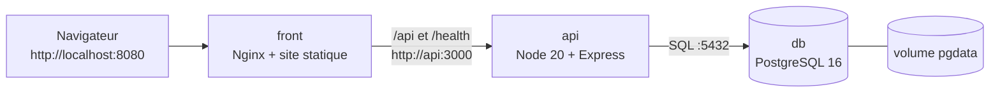

# Architecture de TaskFlow

Ce document répond à la question : *« qu'est-ce qui tourne où, et qui parle à qui ? »*
Il décrit l'état **de départ** (développement). **Complétez-le au fil de la semaine** : staging et production
(jour 3), infrastructure en code (jour 4), monitoring (jour 4), contrôles de sécurité (jour 5).

## Développement (`compose.yaml`)

| Service | Construit depuis | Port publié | Rôle |
| --- | --- | --- | --- |
| `front` | `front/Dockerfile` (multi-stage : build Vite puis Nginx) | `8080` | Sert le site, relaie `/api/` et `/health` vers l'API |
| `api` | `api/Dockerfile` (Node 20, utilisateur `node`, healthcheck) | non publié | API REST, une ligne de log JSON par requête |
| `db` | image `postgres:16-alpine` | non publié | Stockage (volume nommé `pgdata`) |

Les trois services se joignent **par leur nom** sur le réseau privé créé par Compose.

## Santé

- `GET /health` → `{ "status": "ok", "db": "up", "version": "dev", "env": "local" }`, ou **503** si la base est injoignable.
- Chaque conteneur a un `healthcheck` : `docker compose ps` affiche `healthy` / `unhealthy`.

## À compléter

- [ ] Environnements staging et production : qui les déploie, sur quels ports, avec quelle configuration
- [ ] Chaîne de livraison (workflows, runner, registre d'images)
- [ ] Infrastructure décrite en code
- [ ] Supervision : métriques, dashboards, alertes
- [ ] Contrôles de sécurité du pipeline
